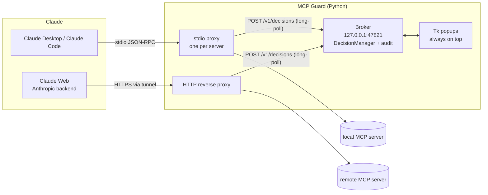

# MCP Guard

**Approve or block every MCP request Claude makes, before it runs.**

MCP Guard is a Python background application that sits between Claude (Desktop, Web and the
Claude Code CLI) and the MCP servers it uses. Every tool invocation is held while an
always-on-top dialog shows what is about to happen (which app, which server, which tool, with
which arguments). Nothing reaches the MCP server until you click **Allow**. **Block** returns a
clean, MCP-compliant denial to Claude instead, and Claude tells the user the action was blocked.

```
Claude ──▶ MCP Guard proxy ──(held)──▶ MCP server
                  │
                  └──▶ broker ──▶ ┌──────────────────────────────┐
                                  │ Claude wants to run a tool   │
                                  │ Server: guard-demo           │
                                  │ Tool:   delete_note          │
                                  │ Args:   {"title": "Q3 ..."}  │
                                  │        [Block]   [Allow]     │
                                  └──────────────────────────────┘
```

---

## Contents
1. [Verification status](#verification-status)
2. [Features](#features)
3. [Quick start](#quick-start)
4. [Setup: Claude Desktop](#setup-claude-desktop)
5. [Setup: Claude Web](#setup-claude-web)
6. [Setup: Claude Code CLI](#setup-claude-code-cli)
7. [Architecture](#architecture)
8. [How interception works and why this approach](#how-interception-works-and-why-this-approach)
9. [Edge cases and how each is handled](#edge-cases-and-how-each-is-handled)
10. [Security](#security)
11. [Testing](#testing)
12. [Self-review: bugs found and fixed](#self-review-bugs-found-and-fixed)
13. [Limitations](#limitations)
14. [Project layout](#project-layout)

---

## Verification status

Development and testing were done on **Windows 10 with Python 3.12**. The table states exactly what
was verified and how.

| Client / area | How it was verified | Result |
|---|---|---|
| **Claude Desktop 4.29.0** | Installed with `mcp_guard install --with-demo`. A real chat in Claude Desktop called `get_weather`; the MCP Guard popup appeared; the request was allowed and executed (recorded in `~/.mcp_guard/audit.jsonl`, `source: claude-desktop`). | ✅ Allow verified live. Block from Claude Desktop: see the demo video. |
| **Claude Code CLI 2.1** (real Anthropic MCP client, real model) | `scripts/e2e_real_clicks.py --claude-code`: Claude Code is told to call `get_weather` and `delete_note`; the real popups are clicked (Allow, then Block). | ✅ Allow executed. Block enforced: the note stayed on disk and Claude replied *"MCP Guard blocked the call, so the note was not deleted."* |
| **Claude Web transport** (Streamable HTTP + SSE) | The HTTP proxy is tested with the official MCP SDK HTTP client, plus real popup clicks. | ✅ Allow, Block, concurrency, cancellation, secret path |
| **Claude Web via claude.ai custom connector** (live, through a tunnel) | Needs a public tunnel and a connector in the user's claude.ai account; steps below. | ⏳ Not yet run live; see the demo video |
| **Real third-party MCP server** | Official `@modelcontextprotocol/server-filesystem` (Node, via `npx`) behind the guard. | ✅ Allow `list_directory` returns real files. Block `write_file` means the file is **not** created. |
| **Automated test-suite** | `pytest`: 36 tests | ✅ 36/36 |
| **Real UI end-to-end** (real popups, real mouse and keyboard) | `scripts/e2e_real_clicks.py`: 27 checks, or 31 with `--claude-code` | ✅ 31/31 |
| macOS / Linux | Code paths exist (config locations, process handling) but were **not tested**. | ⚠️ Untested |

## Features

- **Intercepts every `tools/call`** from Claude Desktop and Claude Code (stdio servers) and from
  Claude Web (remote connectors over Streamable HTTP). Other methods such as `resources/read` can be
  gated too with `--intercept`.
- **Always-on-top confirmation dialog** showing the source app, MCP server, tool, the tool's
  description, its risk hints (destructive, read-only, external) and the full pretty-printed
  arguments. The window title names the tool, so the taskbar shows what is waiting.
- **Allow / Block**, plus an optional *remember my choice for this tool* until the next restart.
- **Requests stay pending** until you decide. Approved requests are forwarded byte-for-byte; blocked
  ones get an MCP-compliant denial (`isError: true`) that Claude reads and explains.
- **Concurrent requests**: each gets its own dialog (cascaded, "Pending request 2 of 3") and can be
  decided in any order. Other traffic (`tools/list`, `ping`, notifications) keeps flowing while a
  call is held.
- **Background service**: the broker auto-starts on the first request, runs without a console window,
  survives the process that launched it, and is a single instance.
- **Fail-closed**: if the approval service is unreachable, crashes or times out (120 s by default),
  the request is **blocked**, never silently allowed.
- **Audit log** of every request and decision in `~/.mcp_guard/audit.jsonl`.
- **One-command install/uninstall** for Claude Desktop, with automatic config backups.

## Quick start

Requirements: **Python 3.10+** (Tkinter is included with the standard Windows installer). Node.js is
only needed for Node-based MCP servers such as the filesystem server.

```bash
git clone <this repo> mcp-guard && cd mcp-guard
python -m venv .venv
.venv\Scripts\activate            # macOS/Linux: source .venv/bin/activate
pip install -e ".[demo]"          # use ".[dev]" to also run the tests
```

Try it **without Claude** first. This script plays the role of Claude Desktop:

```bash
python scripts/simulate_claude.py              # four tool calls, one after another
python scripts/simulate_claude.py --parallel   # all four at once -> four popups
```

Click Allow on some and Block on others. The terminal shows what "Claude" received.

| Command | What it does |
|---|---|
| `python -m mcp_guard broker [--timeout 120]` | Run the approval service (normally auto-started) |
| `python -m mcp_guard status` | Is it running? What is pending? |
| `python -m mcp_guard stop` | Stop it. Anything still pending is **blocked** |
| `python -m mcp_guard install [--with-demo] [--only NAME ...] [--dry-run]` | Route Claude Desktop's MCP servers through MCP Guard |
| `python -m mcp_guard uninstall` | Restore the original Claude Desktop config |
| `python -m mcp_guard stdio --name N [--source claude-code] -- CMD ...` | Wrap one stdio server (what `install` writes) |
| `python -m mcp_guard http --upstream URL [--port 8800]` | Guard a remote MCP server for Claude Web |

## Setup: Claude Desktop

1. Install Claude Desktop, sign in, and add MCP servers as usual. Optionally add the bundled demo
   server with `--with-demo` in the next step.
2. Wrap the servers:
   ```bash
   python -m mcp_guard install --with-demo
   ```
   This finds `claude_desktop_config.json` (`%APPDATA%\Claude\` on Windows; Microsoft Store installs
   under `%LOCALAPPDATA%\Packages\Claude_*` are also searched), writes a timestamped backup, and
   rewrites each entry:
   ```jsonc
   // before
   "filesystem": { "command": "npx", "args": ["-y", "@modelcontextprotocol/server-filesystem", "C:/work"] }
   // after
   "filesystem": { "command": "C:/.../python.exe",
                   "args": ["-m", "mcp_guard", "stdio", "--name", "filesystem", "--",
                            "npx", "-y", "@modelcontextprotocol/server-filesystem", "C:/work"] }
   ```
3. **Fully quit** Claude Desktop (tray icon, then Quit) and start it again.
4. Ask Claude to use a tool, for example *"What's the weather in Mumbai? Use the guard-demo tool."*
   Claude Desktop may first show its *own* tool-permission prompt; after that, the MCP Guard popup
   decides whether the request actually runs.

`python -m mcp_guard uninstall` restores the exact original entries (verified by test). Environment
variables and other keys are preserved either way.

## Setup: Claude Web

Claude Web **does not run MCP servers on your computer**. A custom connector is a URL that
Anthropic's servers call over MCP's Streamable HTTP transport, and your browser never sees this
traffic (see [why](#how-interception-works-and-why-this-approach)). So MCP Guard intercepts it in front
of the MCP server, as a reverse proxy:

```bash
# 1. the MCP server you want to protect (here: the bundled demo)
python -m demo_server --http --port 9000

# 2. MCP Guard in front of it
python -m mcp_guard http --upstream http://127.0.0.1:9000 --name guard-demo --port 8800
#    prints: local URL http://127.0.0.1:8800/<secret>/mcp

# 3. expose it over HTTPS (any tunnel works)
cloudflared tunnel --url http://127.0.0.1:8800       # or: ngrok http 8800
```

4. In claude.ai, open **Settings, then Connectors, then Add custom connector**, and paste
   `https://<tunnel-host>/<secret>/mcp`.
5. Enable the connector in a chat and ask Claude to use one of its tools. The popup appears on your PC
   and Claude's request waits until you answer.

The random `<secret>` path segment keeps internet scanners away from the tunnel. Every other path
gets a bare 404 and never reaches the MCP server or the popup.

## Setup: Claude Code CLI

Claude Code launches stdio MCP servers just like Claude Desktop, so the same proxy works. Wrap the
server command when adding it:

```bash
claude mcp add guard-demo -- python -m mcp_guard stdio --name guard-demo --source claude-code -- python -m demo_server
```

or in an `--mcp-config` JSON file:

```json
{"mcpServers": {"guard-demo": {"command": "python",
  "args": ["-m", "mcp_guard", "stdio", "--name", "guard-demo", "--source", "claude-code", "--",
           "python", "-m", "demo_server"]}}}
```

`--source claude-code` only changes the label in the popup ("Claude Code CLI (stdio)").

## Architecture



| Component | File | Responsibility |
|---|---|---|
| **stdio proxy** | `mcp_guard/stdio_proxy.py` | Started by Claude instead of the real server. Spawns the real server, relays newline-delimited JSON-RPC both ways, holds intercepted requests. Uses a stdin reader thread and a stdout writer thread so the asyncio loop never blocks. |
| **HTTP proxy** | `mcp_guard/http_proxy.py` | Reverse proxy for Streamable HTTP. Inspects POST bodies, holds intercepted requests, streams SSE responses through unchanged, honours `notifications/cancelled`. |
| **Gate** | `mcp_guard/gate.py` | The single policy point both proxies call. Turns every failure into *block* (fail-closed). |
| **Broker client** | `mcp_guard/broker_client.py` | Finds the broker (discovery file), starts it detached if needed, long-polls for a decision. |
| **Broker** | `mcp_guard/broker.py` | Long-lived background process. Authenticated localhost API, `DecisionManager` (pending requests, timeouts, remembered rules, shutdown), audit log. Tk on the main thread, aiohttp on a worker thread. |
| **UI** | `mcp_guard/ui.py` | One always-on-top Tk dialog per pending request. Thread-safe API (`show` / `close` / `quit`). |
| **Protocol** | `mcp_guard/protocol.py` | Transport-independent JSON-RPC helpers: what to intercept, how to describe it, what a denial looks like. |
| **Installer** | `mcp_guard/install.py` | Wraps and unwraps `claude_desktop_config.json` entries, with backups. |

**Why a separate broker process?** Claude starts one proxy process *per MCP server* and restarts them
freely, and the HTTP proxy is a separate process again. One broker gives a single place for all
popups, a shared "remember" rule set, one audit log, and one queue of concurrent requests across every
server and every Claude app. The proxies stay small and stateless.

**Life of a request:**
1. Claude sends `{"jsonrpc":"2.0","id":7,"method":"tools/call","params":{"name":"delete_note",...}}`.
2. The proxy recognises an intercepted method, parks it in its own asyncio task (other messages keep
   flowing), and `POST`s a description to the broker.
3. The broker's `DecisionManager` creates a future, opens a dialog, and starts the timeout.
4. **Allow**: the proxy forwards the *original bytes* to the server, and the server's response flows
   back to Claude unchanged.
   **Block**: the proxy answers Claude itself:
   ```json
   {"jsonrpc":"2.0","id":7,"result":{"isError":true,"content":[{"type":"text",
    "text":"Blocked by MCP Guard: denied by user"}]}}
   ```
   `isError` results are the MCP-spec way to report a tool failure, so the model sees the reason and
   tells the user, as observed with Claude Code. Non-tool methods get a JSON-RPC error (`-32001`).

## How interception works and why this approach

**Claude Desktop and Claude Code** launch local MCP servers as child processes and speak JSON-RPC
over their stdin/stdout. Wrapping the launch command is the most reliable interception point:
- it sees **every** message with full fidelity (server name, tool name, arguments), with no TLS,
  no process injection and no undocumented internals;
- it works with any MCP server in any language (tested with Python and Node servers);
- it is fully reversible (`uninstall`), and the original command stays visible in the config.

**Claude Web** has no local MCP traffic at all: claude.ai's backend connects to the connector URL
server-to-server. A browser extension, a system proxy or mitmproxy on the user's PC therefore
cannot see or stop those tool calls; the browser only receives the rendered result. The only
reliable point is the path into the MCP server, so MCP Guard runs a reverse proxy in front of it,
exposed through a tunnel. Streamable HTTP lets a POST stay open while waiting, so holding a request
until the user decides needs no protocol tricks.

Alternatives considered and rejected:
- *MITM proxy plus a root certificate on the user's PC*: invasive, breaks certificate pinning, and
  still cannot see Claude Web's server-side MCP calls.
- *Patching or injecting into Claude Desktop*: fragile across updates, and unacceptable from a
  security point of view.
- *A new MCP server that re-implements tools*: it would only protect its own tools, not the servers
  the user already has.

## Edge cases and how each is handled

Every row is covered by an automated test (`tests/...`) or the real-click run (`e2e`).

| Situation | Behaviour | Verified by |
|---|---|---|
| Several requests at once | Each held independently with its own dialog and timeout; decisions in any order | `test_concurrent_requests_decided_independently` (5 calls, answered in reverse), `test_concurrent_http_requests`, e2e (4 real popups) |
| Other traffic while a call is held | Passes straight through | `test_other_traffic_flows_while_a_call_is_held` |
| Claude cancels (stdio `notifications/cancelled`) | Popup closes, request never forwarded | `test_cancelled_request_withdraws_popup_and_is_never_forwarded` |
| Claude cancels (HTTP: separate cancel POST) | Held request withdrawn, popup closes | `test_cancel_notification_withdraws_held_http_request` |
| HTTP client disconnects | Popup closes | `test_client_disconnect_withdraws_popup` |
| No answer | Auto-**blocked** after `--timeout` (default 120 s); countdown shown | `test_timeout_blocks_request`, e2e |
| Broker not running | Auto-started detached; if it cannot be reached: **blocked** | `test_fail_closed_when_broker_unreachable`, e2e |
| Broker killed mid-decision | Request blocked; the next request restarts the broker | e2e (`taskkill /F` on the broker) |
| Broker stopped with requests pending | All pending requests blocked with a reason | `test_shutdown_blocks_everything_pending`, e2e |
| MCP server crashes while a call is held | Held request gets an error, popup closes, proxy exits with the server's code | `test_held_request_gets_error_when_server_crashes`, `test_proxy_reports_server_crash_exit_code` |
| Write to a dead server | The request is answered with an error instead of dropping it | `test_forward_to_dead_server_answers_with_error_instead_of_dying` |
| Claude quits (closes stdin) | Proxy closes the server's stdin, waits, then terminates or kills it; exits 0 | `test_proxy_exits_when_claude_closes_stdin` |
| Server binary missing | Proxy exits with code 127 and logs why | `test_missing_server_binary` |
| Large messages | Relayed intact (tested at 2 MB; per-line limit 64 MB); dialog preview truncated | `test_large_message_passes_through`, `test_preview_truncates_huge_arguments` |
| JSON-RPC batch (stdio) | Each member decided separately | `test_batch_with_mixed_decisions` |
| JSON-RPC batch (HTTP) | All-or-nothing: one HTTP request cannot be partially executed | `test_http_batch_is_all_or_nothing` |
| Duplicate pending request id | Rejected with JSON-RPC error `-32600` | `test_duplicate_pending_request_id_is_rejected` |
| Second broker started | Fails to bind the port, exits with code 1 | `test_second_broker_refuses_to_start` |
| Click arrives after timeout | Ignored safely | `test_late_click_after_timeout_is_ignored` |
| "Remember my choice" | Applies to identical requests already waiting and to future ones | `test_remember_choice_applies_to_waiting_and_future_calls` |
| Upstream HTTP server down | `502` | `test_upstream_down_returns_502` |

Logs: `~/.mcp_guard/logs/*.log` (stdio proxy logs also appear in Claude Desktop's MCP logs).
Audit trail: `~/.mcp_guard/audit.jsonl`. Set `MCP_GUARD_HOME` to relocate everything.

## Security

| Measure | Verified by |
|---|---|
| **Fail-closed everywhere**: errors, timeouts, an unreachable broker and shutdown all lead to *block* | tests above + e2e |
| **Broker API is localhost-only** and needs a random per-start 256-bit token (read by proxies from `~/.mcp_guard/broker.json`), compared in constant time | `test_rejects_missing_or_wrong_token` |
| **No browser can drive the broker**: requests with an `Origin` header or a foreign `Host` are rejected (CSRF / DNS rebinding) | `test_rejects_browser_origin_and_foreign_host` |
| Malformed requests to the broker are rejected | `test_rejects_malformed_bodies` |
| **No accidental approvals**: Esc and the window's close button mean *Block*; deliberately no Enter-to-allow shortcut, so typing in another app cannot approve | e2e (real Esc key and close button) |
| **HTTP proxy secret path**: unguessable URL segment; every other path gets a bare 404 | `test_wrong_secret_path_is_404_and_never_reaches_upstream` |
| **Arguments are displayed, never interpreted**: read-only text widget, size-limited | `test_preview_truncates_huge_arguments` |
| **Tool annotations labelled as the server's claim** ("the server marks this tool as..."), since a malicious server could lie | design |
| **Config changes are backed up** before every install or uninstall | `test_install_uninstall_roundtrip` |

Notes:
- The audit log stores tool arguments (truncated when huge). It lives in the user's profile; delete
  it if arguments may contain secrets.
- Hop-by-hop headers are stripped by the HTTP proxy; the client's `Authorization` header is passed to
  the upstream server.
- *Threat model*: MCP Guard protects the user from unwanted actions by Claude and MCP servers. Malware
  already running as the same OS user could edit the Claude config or the discovery file, and
  defending against that is out of scope (and true of any user-space tool).

## Testing

There are three layers, all run on Windows 10.

**1. Automated test-suite: 36 tests, about 40 s**
```bash
pip install -e ".[dev]"
python -m pytest -q
```
The end-to-end tests use the **official MCP Python SDK client** as "Claude", launching the proxy
exactly as Claude Desktop does, together with the real broker HTTP API and `DecisionManager`. Only the
human click is scripted (`tests/conftest.py::ScriptedUI`). `tests/test_ui.py` drives the real Tk
dialog.

**2. Real UI end-to-end: 31 checks, about 2 min**
```bash
pip install pillow
python scripts/e2e_real_clicks.py --claude-code     # omit --claude-code to skip the Claude Code part
```
Nothing is mocked. The broker is the real auto-started process. The script finds each popup by its
window title, locates the green or red button on screen and clicks it with the real mouse (and
presses the real Esc key). It covers:
- Allow, Block, the close button and Esc
- 4 simultaneous popups
- install and uninstall, and the Node filesystem server
- the HTTP path
- killing the broker, timeout, and `stop` with a pending request
- real **Claude Code** making tool calls through the guard

Last run: **31/31 passed**.

**3. Manual testing with Claude Desktop**: see [verification status](#verification-status) and the demo
video.

## Self-review: bugs found and fixed

Each bug below was found by code review or by the tests above, fixed, and covered by a test.

| # | Found by | Problem | Fix |
|---|---|---|---|
| 1 | Code review | Broker liveness check used `os.kill(pid, 0)`, which on **Windows sends CTRL+C** to the process | Removed; binding the port is the single-instance check |
| 2 | Test (`test_proxy_reports_server_crash_exit_code`) | Proxy crashed with `0xC0000005` on exit when the server died, because the stdin reader thread was still blocked during interpreter shutdown | Flush output, then `os._exit(code)` |
| 3 | Live run | Auto-started broker was killed along with the process tree of whatever launched it (Windows Job Objects) | Spawn with `CREATE_BREAKAWAY_FROM_JOB`, with a fallback |
| 4 | Real-click test | Stacked popups re-asserted "topmost" every second and **jumped over each other**, so the user could click the wrong one | Re-assert only if the OS flag was actually lost |
| 5 | Test (`test_large_message_passes_through`) | Writes to Claude happened on the event loop; a slow reader or a multi-MB result could stall every other pending request | Dedicated writer thread with back-pressure |
| 6 | Code review | HTTP: Claude's cancel (a separate POST) was ignored, so the popup stayed open and a later Allow would run a request Claude had abandoned | Track held requests per session and withdraw them on cancel |
| 7 | Code review | stdio: a write failure to a dead server ended the input loop without replying | Answer the request with a JSON-RPC error |
| 8 | README review | README claimed behaviours that had no test | A test was added for each claim, or the claim was removed |

## Limitations

- **Claude Web needs the connector routed through MCP Guard.** Built-in connectors that Anthropic
  operates (e.g. Google Drive, Gmail) are called entirely inside Anthropic's infrastructure and cannot
  be intercepted by any local tool.
- Claude Desktop **extensions** (`.mcpb`/`.dxt`, installed from Settings, then Extensions) are not
  listed in `claude_desktop_config.json`, so `install` does not wrap them. Add the same server as a config
  entry to have it guarded.
- "Remember my choice" rules last until the broker restarts; they are not persisted.
- The broker uses a fixed localhost port (47821), so only one broker runs per machine, even with a
  different `MCP_GUARD_HOME`.
- Tested on Windows 10 only (see [verification status](#verification-status)).
- The popup uses Tkinter for zero extra dependencies: functional rather than fancy.

## Project layout

```
mcp_guard/
  __main__.py        CLI: broker | stdio | http | install | uninstall | status | stop
  broker.py          background service: API, DecisionManager, lifecycle
  broker_client.py   discovery, detached auto-start, long-poll
  gate.py            fail-closed policy point used by both proxies
  stdio_proxy.py     Claude Desktop / Claude Code interception
  http_proxy.py      Claude Web interception
  protocol.py        JSON-RPC / MCP helpers
  ui.py              Tk popups
  install.py         claude_desktop_config.json wrap/unwrap
  audit.py, config.py, logging_setup.py
demo_server/         harmless demo MCP server (stdio or HTTP)
scripts/
  simulate_claude.py     try it without Claude
  e2e_real_clicks.py     real-popup, real-mouse end-to-end run (Windows)
tests/               pytest suite (36 tests)
```
